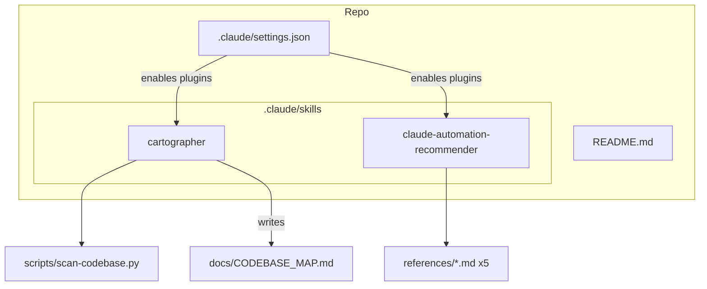
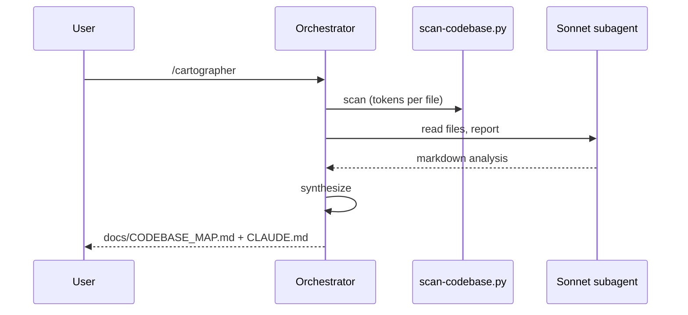

# Codebase Map

> Auto-generated by Cartographer. Last mapped: 2026-10-12T23:17:41Z
> Token total is an estimate (~4 bytes/token); tiktoken could not download its encoding in this environment.

## System Overview

The repository "ARQUIVOS E DECISÕES GDSXSR" (Gabinete do Des. Sérgio Rocha, TJDFT) tracks **no application code and no decision documents**. It holds only Claude Code tooling: a settings file, two vendored third-party skills, and a 2-line README. The legal workflow (revisão de votos, minutas) lives outside this repo (user-level skills, Google Drive, MCP servers iajus/Precedentes, and project files under `/mnt/project-files`).



## Directory Structure

```
.
├── README.md                       # placeholder title (57 B)
├── docs/CODEBASE_MAP.md            # this file
├── CLAUDE.md                       # summary pointing here
└── .claude/
    ├── settings.json               # marketplaces, enabled plugins, privacy env
    └── skills/
        ├── cartographer/           # MIT; maps codebases via Sonnet subagents
        │   ├── SKILL.md
        │   ├── LICENSE
        │   └── scripts/scan-codebase.py
        └── claude-automation-recommender/   # Apache-2.0; read-only recommender
            ├── SKILL.md
            ├── LICENSE
            └── references/ {hooks-patterns, mcp-servers, plugins-reference, skills-reference, subagent-templates}.md
```

## Module Guide

### Project settings
**Entry point**: `.claude/settings.json` (573 B)
- `extraKnownMarketplaces`: `kingbootoshi/cartographer`, `thedotmack/claude-mem`.
- `enabledPlugins`: `cartographer@cartographer-marketplace`, `claude-code-setup@claude-plugins-official`, `claude-mem@thedotmack`.
- `env`: `DO_NOT_TRACK=1`, `CLAUDE_MEM_ONLINE_OPTIN=false`, `CLAUDE_MEM_CLOUD_SYNC_HUB_URL=""` (offline/privacy posture).
- No hooks, permissions or MCP entries.

### cartographer skill
**Purpose**: map a codebase with parallel Sonnet subagents; write `docs/CODEBASE_MAP.md` and update CLAUDE.md.

| File | Purpose | ~Size |
|------|---------|-------|
| SKILL.md | 8-step workflow, map template, update mode, token budgets (Sonnet 150k) | 8.7 KB |
| scripts/scan-codebase.py | tiktoken-based file scanner | 14 KB |
| LICENSE | MIT (Bootoshi) | 1 KB |

**Scanner CLI**: `scan-codebase.py [path] [--format json|tree|compact] [--max-tokens 50000] [--encoding cl100k_base]`. PEP 723 header (`tiktoken`). Skips VCS/build dirs, lockfiles, binaries/media/PDF, files >1 MB or over max tokens; honors only the root `.gitignore`.

### claude-automation-recommender skill
**Purpose**: read-only analysis recommending MCP servers, skills, hooks, subagents and plugins (tools: Read, Glob, Grep, Bash). `SKILL.md` (11 KB) reads five static reference files (hooks 6 KB, mcp 8 KB, plugins 3 KB, skills 10 KB, subagent templates 5 KB). Apache-2.0.

## Data Flow



## Conventions
- Skills follow the `SKILL.md` + frontmatter (`name`, `description`) layout; supporting files in `scripts/` and `references/`.
- Vendored skills are copies of plugin skills and do not reference each other.

## Gotchas
- **Nothing legal is tracked.** Votos, minutas and decisões (.docx/.pdf) are not in git; the scanner would skip them anyway (binary/PDF).
- `scan-codebase.py` needs network on first use to download the tiktoken encoding; it fails behind a restrictive proxy (as happened here).
- `${CLAUDE_PLUGIN_ROOT}` in cartographer's SKILL.md only resolves as a plugin; for the vendored copy use `.claude/skills/cartographer/scripts/scan-codebase.py`.
- Marketplace key `cartographer` vs plugin ref `cartographer@cartographer-marketplace` may be a name mismatch; unverified.
- Scanner caveats: no `.gitignore` negation, no nested `.gitignore`, no symlink-loop guard.
- The recommender's detection commands assume a JS-style repo and find nothing here.

## Navigation Guide
- **Change plugins/privacy env**: `.claude/settings.json`.
- **Change mapping behavior**: `.claude/skills/cartographer/SKILL.md`.
- **Change scan rules**: `.claude/skills/cartographer/scripts/scan-codebase.py` (`DEFAULT_IGNORE`).
- **Change recommendation catalogs**: `.claude/skills/claude-automation-recommender/references/`.
- **Legal review workflow**: not in this repo; see project files and user-level GDSXSR skills.
